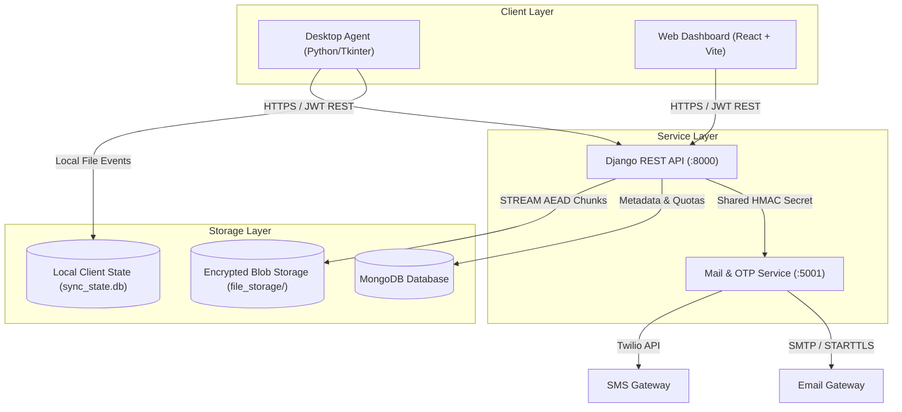
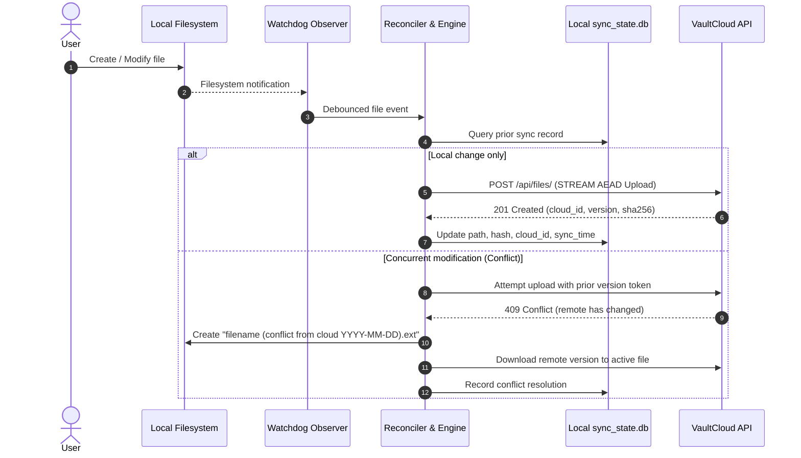

# VaultCloud — Secure Hybrid Cloud Synchronization & Storage

[](https://www.python.org/)
[](https://www.djangoproject.com/)
[](https://react.dev/)
[](https://vitejs.dev/)
[](https://www.mongodb.com/)
[](https://en.wikipedia.org/wiki/Galois/Counter_Mode)
[](LICENSE)

**VaultCloud** is a self-hosted, enterprise-grade cloud storage and continuous synchronization platform. It unites a **Django REST API** backend, **Rogaway STREAM AES-256-GCM envelope encryption**, a **React + Vite** web dashboard, a dedicated **Flask Mail & OTP microservice**, and an autonomous **Python Tkinter Desktop Agent** with event-driven bidirectional synchronization.

---

## Architecture Overview



---

## Bidirectional Synchronization Flow

The desktop agent monitors local directories and reconciles state with the cloud using a 3-way reconciliation state machine:



---

## Security Model & Cryptography

VaultCloud implements **Server-Side Envelope Encryption (AES-256-GCM)** designed for multi-client accessibility and cryptographic integrity:

### Cryptographic Hierarchy
1. **Master Key Encryption Key (KEK)**: 256-bit AES master key loaded strictly via environment variable (`FILE_ENCRYPTION_KEK`) or external secret manager. Silent fallbacks are strictly prohibited in production.
2. **Data Encryption Key (DEK)**: Unique 256-bit cryptographically secure random key generated per uploaded file version (`os.urandom(32)`).
3. **DEK Wrapping**: DEK is wrapped using the Master KEK with AES-256-GCM, storing the resulting ciphertext and 12-byte initialization vector (`dek_iv`) in database metadata.
4. **Streaming AEAD (`VC02` Format)**:
   - Chunked Rogaway STREAM construction with fixed 64 KiB blocks.
   - Nonce-derivation uses a 7-byte random prefix + 4-byte monotonic chunk counter + 1-byte end-of-stream flag (`\x00` interim, `\x01` final).
   - O(1) constant memory footprint regardless of file size (tested up to 100 MB limits).
   - Instant tamper detection: bit-flips, reordering, and truncated streams raise `CryptographicIntegrityError`.

> [!NOTE]
> **Architecture Clarification**: VaultCloud uses **Server-Side Envelope Encryption**, not Zero-Knowledge encryption. The Master KEK is managed server-side, enabling full web dashboard previewing, thumbnailing, and direct browser downloads without requiring client-side WebAssembly decryption keys.

---

## Service Port Configuration

| Component | Default Port | Environment Variable | Protocol |
|---|---|---|---|
| Django REST API | `8000` | `PORT` / `VAULTCLOUD_BACKEND_URL` | HTTP / HTTPS |
| Web Dashboard | `5173` | `PORT` / `VAULTCLOUD_WEB_URL` | HTTP / HTTPS |
| Mail & OTP Microservice | `5001` | `OTP_SERVICE_PORT` | HTTP / HTTPS |
| MongoDB Database | `27017` | `MONGO_URI` | MongoDB Wire (TLS) |

---

## Prerequisites

- **Python**: 3.11+ (Python 3.12 recommended)
- **Node.js**: 18+ (Node 20+ or 22+ recommended)
- **MongoDB**: Community Server 6.0+ or MongoDB Atlas Cluster
- **Virtualenv**: Python standard `venv`

---

## Quickstart Guide

### 1. Clone & Setup Python Virtual Environment
```bash
git clone https://github.com/adityaB-code100/File_Backup_Sync.git
cd File_Backup_Sync

# Create and activate virtual environment
python -m venv venv
.\venv\Scripts\Activate.ps1   # Windows PowerShell
# source venv/bin/activate    # Linux / macOS

# Install dependencies
pip install -r requirements.txt
pip install -r mail_otp_server/requirements.txt
```

### 2. Configure Environment Files
```bash
cp .env.example .env
cp mail_otp_server/.env.example mail_otp_server/.env
cp frontend/.env.example frontend/.env
```
Generate a cryptographically secure 256-bit Master KEK and set `FILE_ENCRYPTION_KEK`:
```bash
python -c "import os, base64; print(base64.b64encode(os.urandom(32)).decode())"
```

### 3. Start Backend Services

**Terminal 1 — Mail & OTP Service:**
```bash
python mail_otp_server/run.py
```

**Terminal 2 — Django REST API:**
```bash
python backend/manage.py migrate
python backend/manage.py runserver 8000
```

**Terminal 3 — React Web Dashboard:**
```bash
cd frontend
npm install
npm run dev
```

**Terminal 4 — Desktop Agent GUI:**
```bash
python -m app.main
```

---

## Environment Variables Reference

### Root & Backend (`.env`)
```ini
SECRET_KEY=your-django-cryptographic-secret-key-here
DEBUG=True
ALLOWED_HOSTS=localhost,127.0.0.1
MONGO_URI=mongodb://localhost:27017/cloud_storage_db
FILE_ENCRYPTION_KEK=your-base64-32-byte-master-kek-here
OTP_SERVICE_URL=http://localhost:5001
OTP_SERVICE_SECRET=your-shared-internal-otp-secret-here
VAULTCLOUD_WEB_URL=http://localhost:5173
VAULTCLOUD_BACKEND_URL=http://localhost:8000/api
MAX_UPLOAD_SIZE_BYTES=104857600
```

### Mail & OTP Microservice (`mail_otp_server/.env`)
```ini
OTP_SERVICE_PORT=5001
OTP_SERVICE_SECRET=your-shared-internal-otp-secret-here
SMTP_SERVER=smtp.gmail.com
SMTP_PORT=587
SMTP_USE_TLS=True
SMTP_USER=your-email@gmail.com
SMTP_PASSWORD=your-app-specific-password
```

### Frontend Dashboard (`frontend/.env`)
```ini
VITE_API_URL=http://localhost:8000/api
```

---

## Automated Verification

Run all test suites across the entire stack:
```bash
# Execute master test suite
python tests/run_all_tests.py

# Execute specific suite
python tests/run_all_tests.py --suite security
python tests/run_all_tests.py --suite desktop
python tests/run_all_tests.py --suite frontend
python tests/run_all_tests.py --suite otp
```

---

## Project Status & Limitations

- **Upload Limit**: 100 MB per file version (enforced at frontend, streaming middleware, and crypto layers).
- **Timezone**: Internally persisted in strict UTC; rendered in the web dashboard in `Asia/Kolkata` (IST, UTC+05:30).
- **Physical Offsite Replication**: Local storage is active; multi-region cold-storage disaster recovery is scheduled for the production deployment phase.

---

## License

This project is licensed under the MIT License — see the [LICENSE](LICENSE) file for details.
