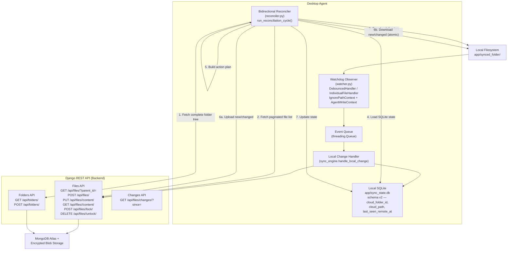
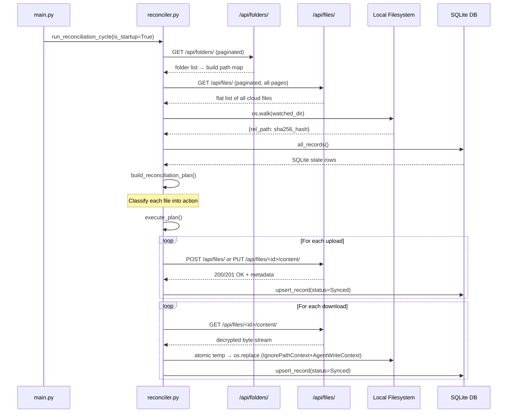

# VaultCloud — Bidirectional Sync Architecture

**Document Version**: 1.0  
**Date**: November 2026  
**Branch**: `main` (committed as `bidirectional-sync` changes — see Implementation doc for Git note)

---

## 1. Overview

VaultCloud's desktop synchronization agent was previously unidirectional: it uploaded local changes to the cloud but only polled files already tracked in SQLite. The bidirectional synchronization architecture described here makes the system fully symmetric: cloud-to-local and local-to-cloud changes are discovered, reconciled, and applied correctly.

---

## 2. Updated Architecture



---

## 3. Three-Way State Model

The reconciler merges **three independent sources of truth**:

| Source | Contents | Authoritative For |
|---|---|---|
| **Local Filesystem** | Actual files on disk; SHA-256 hashes | Current user edits |
| **SQLite (`sync_state.db`)** | Last-synced hashes, cloud IDs, cloud versions | The last known good synchronised state |
| **Cloud API** | File metadata from `/api/files/`; `content_hash`, `version_number`, `parent_id` | Remote file tree truth |

---

## 4. Synchronization Flow (Detailed)

### 4.1 Startup Reconciliation



### 4.2 Background Polling (every 30 seconds)

`main.py:start_remote_polling_worker` calls `sync_engine.poll_remote_changes`, which now **delegates entirely to `run_reconciliation_cycle`** — the same full bidirectional reconciliation runs every 30 seconds.

### 4.3 Watcher Event (Local Change)

Filesystem events (create, modify, move, delete) go through the existing `handle_local_change` → `_handle_local_change` path in `sync_engine.py`, which remains unchanged and handles single-file optimistic uploads with locking.

---

## 5. Reconciliation Algorithm

### 5.1 Remote Tree Fetching

```python
_build_folder_path_map(auth)       # GET /api/folders/ (all pages)
  → {folder_id: "relative/path"}

fetch_remote_file_tree(auth)       # GET /api/files/ (all pages, limit=200)
  → inject _folder_rel and _computed_rel onto each file dict
  → returns all active non-deleted files for the user
```

Pagination: the fetcher increments `offset` until `offset + limit >= count` or the response returns fewer items than the page limit.

### 5.2 Plan Building

```
build_reconciliation_plan(local_tree, remote_files, sqlite_records, watched_dir)
```

**Three-pass algorithm**:

| Pass | Input | Purpose |
|---|---|---|
| Pass 1 | SQLite records | Primary key: stable `cloud_id`. Match remote file by cloud_id; build FileState for every tracked file. |
| Pass 2 | Remote files not in SQLite | Discover brand-new cloud files (uploaded via web or another device). |
| Pass 3 | Local files not in SQLite and not in remote | Truly new local files that need first upload. |

### 5.3 Decision Table

```
classify_file_state(state: FileState) → action
```

| Local | Cloud | Last-Synced Hash Exists | Action |
|---|---|---|---|
| Exists | Missing | No | `upload_new` |
| Exists | Missing | Yes (cloud deleted) | `cloud_deleted` |
| Missing | Exists | No | `download_new` |
| Missing | Exists | Yes (local deleted) | `local_deleted` |
| Both | Both | Hashes unchanged on both sides | `noop` |
| Both | Both | Only local changed | `upload_changed` |
| Both | Both | Only cloud changed | `download_changed` |
| Both | Both | Both changed independently | `conflict` |
| Neither | Neither | — | `both_deleted` |
| First encounter | Both, identical hash | None | `noop` (adopt silently) |
| First encounter | Both, different hash | None | `download_changed` (cloud authoritative) |

---

## 6. Cloud-to-Local Download — Atomic Replace Protocol

**BUG-02 root cause**: the old `poll_remote_changes` called `get_cloud_updated_path()` which generated `filename (cloud updated).ext` instead of replacing the file in place.

**Fix implemented in `reconciler._execute_download`**:

```
1. os.makedirs(dest_parent, exist_ok=True)
2. temp_path = abs_dest + ".tmp.<8-hex-chars>"
3. Enter: IgnorePathContext(abs_dest) + AgentWriteContext(abs_dest)
4. drive_client.download_file(auth, cloud_id, temp_path)
5. downloaded_hash = sha256(temp_path)
6. Assert downloaded_hash == state.cloud_hash  (raises ValueError on mismatch)
7. os.replace(temp_path, abs_dest)             (atomic, OS-guaranteed)
8. time.sleep(0.1)                             (allow OS event to settle)
9. db.upsert_record(rel, ..., status="Synced")  (only on success)
```

If any step from 4–7 fails:
- The temp file is deleted.
- The original file remains intact.
- SQLite is not updated.

---

## 7. Loop Prevention — Sync Suppression

A download by the agent must not be treated as a user edit and re-uploaded.

### 7.1 Existing Mechanism: `IgnorePathContext`
The watcher module maintains `ignored_paths: set` protected by `ignored_paths_lock`. Any path inside this set is silently dropped by `DebouncedHandler.on_modified/on_created`.

### 7.2 New Mechanism: `AgentWriteContext`
`reconciler.py` adds a second, independent suppression layer:

```python
_agent_writing: set = set()           # thread-safe via _agent_writing_lock

class AgentWriteContext:
    def __enter__(self): _agent_writing.add(abs_path)
    def __exit__(...):   _agent_writing.discard(abs_path)
```

`watcher.DebouncedHandler.on_modified/on_created` now checks **both** guards:

```python
if abs_path in ignored_paths: return   # IgnorePathContext
from reconciler import is_agent_writing
if is_agent_writing(abs_path): return  # AgentWriteContext
```

Both guards are removed automatically (even on exception), making the suppression always bounded in time.

---

## 8. Conflict Resolution Policy

When both local and cloud have changed since the last successful sync:

1. Compute the conflict copy path: `{base} (conflict from cloud {YYYY-MM-DD HHMMSS}){ext}`.
2. If that path already exists, append a counter: `... {stamp} 2`, `... {stamp} 3`, etc.
3. `shutil.copy2(original_local, conflict_path)` — preserves the user's work.
4. Download the cloud version into the original path using the atomic protocol.
5. Create a SQLite record for the conflict copy (status=`Conflict`, no cloud_id).
6. Set the original file's SQLite record to `status=Synced`.

**Data safety**: neither side's data is ever discarded silently. The user's local version is always preserved as a named conflict copy.

---

## 9. Deletion Handling — Safe Defaults

### Local file deleted, cloud still exists
- Action: `local_deleted`
- SQLite `status` updated to `LocalDeleted`.
- **Cloud file is NOT deleted automatically**. This prevents accidental permanent data loss.
- Recommendation: Implement an explicit "delete from cloud" UI action if desired.

### Cloud file 404 / soft-deleted, local still exists
- Action: `cloud_deleted`
- The SQLite record is **removed** (the file is no longer tracked).
- **Local file is NOT deleted automatically**. This prevents permanent local data loss.

### Rationale
Automatic deletion propagation is a data-loss risk in the presence of network errors (a temporary 404 must not cause a permanent local purge). The current policy is "safe by default: never auto-delete either side."

---

## 10. Concurrency and Locking

### SQLite Concurrency
- Each SQLite write uses `with _get_connection() as conn:` (context manager = auto-commit/rollback).
- Downloads write SQLite only **after** `os.replace` succeeds.
- Uploads write SQLite only **after** the API call returns a successful response.

### Overlapping Reconciliation Cycles
```python
_reconciliation_lock = threading.Lock()

def run_reconciliation_cycle(...):
    if not _reconciliation_lock.acquire(blocking=False):
        # skip — returns {"skipped": True}
        return
```
Two concurrent cycles cannot both run; the second returns immediately.

### File Locking (Cloud)
- Uploads of existing files acquire `POST /api/files/<id>/lock/` before uploading.
- Locks are released in a `finally` block even if the upload raises.
- If the backend returns `HTTP 423 Locked`, the cycle logs a warning and skips that file.
- If the backend returns `HTTP 409 Conflict` (version mismatch), status is set to `Conflict` and the next cycle will reconcile.

---

## 11. Error and Retry Behaviour

| Error | Behaviour |
|---|---|
| `ConnectionError` / `Timeout` during download | Temp file deleted; original intact; SQLite unchanged. Retry on next cycle. |
| `HTTP 401` during any request | `auth.do_refresh()` called; request retried once. |
| `HTTP 403` | Logged; file skipped; no state change. |
| `HTTP 404` for a known cloud file | Logged as `cloud_deleted`; SQLite record removed; local file kept. |
| `HTTP 409` Conflict during upload | SQLite status set to `Conflict`; next cycle re-classifies and resolves. |
| `HTTP 423` Locked during upload | Logged; file skipped; retried next cycle. |
| `HTTP 429` / 5xx | Tenacity retry (5 attempts, exponential backoff 2s–30s) via `_retry_policy` on `drive_client`. |
| Hash mismatch after download | `ValueError` raised; temp file deleted; original preserved; logged as error. |
| Overlapping cycles | Second cycle skips immediately (returns `{"skipped": True}`). |
| Network unavailable during folder fetch | `run_reconciliation_cycle` aborts early and logs error; local files are not touched. |

---

## 12. Performance Characteristics

| Metric | Value / Behaviour |
|---|---|
| Polling interval | 30 seconds (configurable via `start_remote_polling_worker(interval_seconds=…)`) |
| Page size for remote fetch | 200 items/request |
| Memory per cycle | O(N) where N = total file count (all metadata held in RAM during planning) |
| Unchanged files | Zero network traffic (hash comparison is local) |
| Temp file location | Same directory as destination (required for `os.replace` atomicity on Windows) |
| Watcher suppression | Both `IgnorePathContext` and `AgentWriteContext` active during every download |

---

## 13. Schema v2 Additions (SQLite)

New columns added non-destructively in `db.init_db()`:

| Column | Type | Purpose |
|---|---|---|
| `cloud_folder_id` | `TEXT` | MongoDB ObjectId of the parent folder in cloud |
| `cloud_path` | `TEXT` | Full relative path as seen on cloud (`folder/name`) |
| `last_seen_remote_at` | `TEXT` | ISO 8601 timestamp of last successful remote fetch of this file |

Existing columns (`cloud_id`, `last_synced_hash`, `last_synced_cloud_md5`, `cloud_version`, `status`, `last_sync_time`, `error_message`, `is_active`) remain unchanged.
